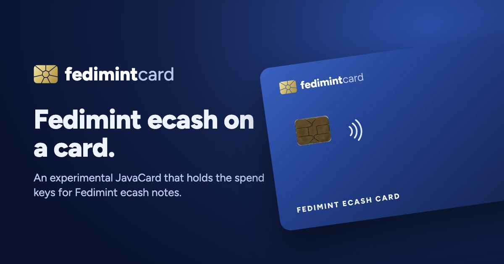

  

  <a href="https://fedimintcard.org"><b>fedimintcard.org</b></a> ·
  <a href="https://fedimintcard.org/#film"><b>See it work</b></a> ·
  <a href="https://github.com/fedimintcard/fedimintcard"><b>Read the source</b></a>

Fedimint Card is an experimental JavaCard that holds the spend keys for [Fedimint](https://fedimint.org) ecash notes and pays by tap. Each note's key is made on the card's own chip and stays there. The till builds the transaction, the card signs it, and the federation checks the signature. It works with a stock Fedimint federation running the `mintv2` module.

## How a payment works

1. **Load.** Ecash from a Fedimint wallet is reissued to keys the card generated on its chip. The federation issues the new notes to those keys.
2. **Tap.** The till builds the spend and sends the card its 32-byte transaction hash. The card signs it with the note's key (BIP340 Schnorr).
3. **Settle.** The guardians check the signature and mark the note spent. Change goes back to keys on the card in the same transaction. The till needs a connection to the federation to take a tap.

## Repositories

| Repository | What it holds |
| --- | --- |
| [**fedimintcard**](https://github.com/fedimintcard/fedimintcard) | The JavaCard applet and its simulator bridge, the Rust host crates and federation tests, the sidecar wallet and till service, and the Android point-of-sale app that reads the card over NFC. The design note and spike results are in `docs/`. |
| [**fedimintcard.org**](https://github.com/fedimintcard/fedimintcard.org) | The site at [fedimintcard.org](https://fedimintcard.org): a static page, its film, and the support and privacy pages, served from a Cloudflare Worker. |

## Status

Fedimint Card is an experimental prototype, and its applet and till code have had no outside security review. In October 2026 an NXP J3R180 card signed a `mintv2` spend that a four-guardian federation accepted, with the key held on the card throughout. A signature takes about 850 ms on that card ([spike results](https://github.com/fedimintcard/fedimintcard/blob/main/docs/SPIKE.md)). The prototype has no PIN or spending limits yet, so keep only small amounts on a card. The [risks](https://fedimintcard.org/#risks) are listed on the site.

Questions go to [Discussions](https://github.com/fedimintcard/fedimintcard/discussions) in fedimintcard/fedimintcard. Fedimint Card is an independent project built on the Fedimint protocol.

## Security

For a vulnerability report, open the affected repository's **Security** tab and choose **Report a vulnerability**, or write to [hi@fedimintcard.org](mailto:hi@fedimintcard.org). [SECURITY.md](https://github.com/fedimintcard/.github/blob/main/SECURITY.md) has the details.

Support: [fedimintcard.org/support](https://fedimintcard.org/support) · Privacy: [fedimintcard.org/privacy](https://fedimintcard.org/privacy) · License: [MIT](https://github.com/fedimintcard/fedimintcard/blob/main/LICENSE)
